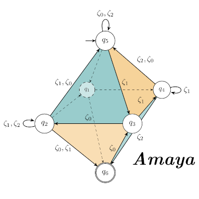

# Amaya

<p align="center">
  
</p>

Amaya is an experimental, automata-based linear integer arithmetic (LIA) SMT solver.

Amaya supports two execution backends:
- a native backend representing transition symbols explicitly. Slow, but offers more experimentation-oriented features such as tracking the semantics of automaton states.
- a high-performance MTBDD-based backend representing transition symbols symbolically using MTBDDs.

## Installing

### Native backend (default)
The native backend requires only the Python packages listed in `requirements.txt`:
```bash
python3 -m venv venv
source venv/bin/activate
pip install -r requirements.txt
```
A system-wide installation of the same packages also works; a virtual environment is not required.

### MTBDD backend (optional, `--backend MTBDD`)
The MTBDD backend is the C++ library in `mtbdd-backend/`. It is compiled into the Cython extension module
`libamaya`, which the Python frontend imports as `from amaya import libamaya` (`amaya/mtbdd_transitions.py`).
It depends on the [Sylvan](https://github.com/trolando/sylvan) BDD library. Only Sylvan **v1.5.0** is supported;
newer releases contain breaking API changes.

Build dependencies:

| Dependency                           | Debian package                       |
|--------------------------------------|--------------------------------------|
| C/C++ compiler with C++20 support    | `gcc`, `g++`                         |
| CMake, make, pkg-config              | `cmake`, `make`, `pkg-config`        |
| Python headers                       | `python3-dev`                        |
| GMP                                  | `libgmp-dev`                         |
| hwloc (required by Sylvan)           | `libhwloc-dev`                       |
| Cython, setuptools (Python packages) | `pip install cython setuptools`      |

1) Build and install Sylvan v1.5.0 (installs into `/usr/local` by default). The `sed` command removes `-Werror`,
   because recent compilers emit warnings on the v1.5.0 sources:
   ```bash
   git clone https://github.com/trolando/sylvan.git
   cd sylvan
   git checkout v1.5.0
   sed -i 's/-Werror//g' CMakeLists.txt
   mkdir build && cd build
   cmake -DBUILD_SHARED_LIBS=ON ..
   make -j"$(nproc)"
   sudo make install
   sudo ldconfig
   ```
2) Build the `libamaya` extension. The `libamaya` target in `mtbdd-backend/Makefile` runs
   `mtbdd-backend/wrapper/compile_wrapper.py` and copies the resulting `libamaya*.so` into `amaya/`.
   The Makefile uses the `python3` found on `PATH`, so activate the virtual environment containing Cython
   first, or select an interpreter explicitly with `PYTHON=...`:
   ```bash
   pip install cython setuptools
   export CPATH=/usr/local/include LIBRARY_PATH=/usr/local/lib LD_LIBRARY_PATH=/usr/local/lib
   make -C mtbdd-backend libamaya            # or: make -C mtbdd-backend libamaya PYTHON=/path/to/python3
   ```
   `CPATH`, `LIBRARY_PATH` and `LD_LIBRARY_PATH` point the compiler, linker and dynamic loader at the Sylvan
   installation; adjust them if Sylvan was installed under a different prefix. They are needed because the
   include and library directories hard-coded in `mtbdd-backend/wrapper/compile_wrapper.py:ext` are specific
   to the development machine.
3) Check that the extension loads:
   ```bash
   python3 -c 'from amaya import libamaya'
   ```

`make -C mtbdd-backend clean` removes all build artifacts, including the copy of `libamaya*.so` in `amaya/`.

### Docker
`Dockerfile` performs all of the steps above on a Debian base image:
```bash
docker build -t amaya .
docker run --rm -it amaya python3 run-amaya.py --backend MTBDD get-sat smt-files/tptp/ARI005=1.smt2
```

## Running
The `run-amaya.py` script provides a user interface to Amaya. This script is current capable of running Amaya in three modes:
- `get-sat`   - single execution of the solver, outputting the SAT value (sat/unsat) of the formula
- `benchmark` - executes and measures the decision procedure runtime (hot-start).
- `convert`   - Run Amaya's preprocessor and output the result in different formats.
The `run-amaya.py` script also provides options that can tweak the decision procedure regardless of the execution mode
(e.g. enable eager minimization). See `./run-amaya.py --help`.

### Get-Sat
```bash
python3 run-amaya.py get-sat FILE
```
The get-sat command evaluates the given SMTLIB2 file and reports the results (sat/unsat). This command supports various
flags for inspecting the evaluation process such as the export of the automatons created during the evaluation, or
writing out the runtime for the individual operations performed during the evaluation etc.

To see a full list of supported switches, see:
```bash
python3 run-amaya.py get-sat --help
```

#### Example - Exporting the intermediate automata created during evaluation of a TPTP benchmark file
The following command will output the automata created during the decision procedure in the order they were created to
the provided folder. The output format of the exported automata can be changed by `--output-format`.
```bash
python3 run-amaya.py --backend MTBDD get-sat --output-created-automata smt-files/tptp/ARI005\=1.smt2
```

### Benchmarks
Run Amaya in the benchmarking mode. This mode requires a set of input files to be specified. See `python3 run-amaya.py
benchmark --help` for information about how to specify the input files.

If the benchmarking runner encounters a file for which the evaluation procedure did yield different results as expected
(specified in the file via the `smt-info` statement) the file will not be rerun and will have its `failed` field in the
report set to `True`.

To see a full list of supported options, see:
```bash
python3 run-amaya.py benchmark --help
```

#### Example - Running the TPTP benchmark
The following command benchmarks Amaya to be run for all SMTLIB2 files present in the `smt-files/tptp` folder (will not be
searched recursively). The option `--backend naive` specifies that the slower, native backend should be used. The
option `--execute-times 10` specifies that every benchmark file should be run 10 times and the average runtime will be
returned.
```bash
python3 run-amaya.py --backend naive benchmark --add-directory smt-files/tptp/ --execute-times 10
```

### Convert
Convert formula from SMTLIB2 into various output formats.

#### Example - Convert SMTLIB2 to the LASH format
The following example converts an SMTLIB2 formula into the LASH format and outputs the result to the stdout.
```bash
./run-amaya.py -p no-congruences -p assign-new-var-names -p nonlinear-term-use-two-vars \
    benchmarks/formulae/20190429-UltimateAutomizerSvcomp2019/jain_7_true-unreach-call_true-no-overflow_false-termination.i_10.smt2
```

Since LASH does not support congruences atoms, Amaya's preprocessor must be instructed to not introduce congruences (`-p no-congruences`)
and rather use inequations. Amaya uses congruences by default, as they offer better runtime characteristics when the moduli in formulae
are powers of 2. Furthermore, as some benchmarks might use symbols that cannot be part of variable identifiers in the LASH format, the
preprocessor is instructed to drop all of the variable names and introduce new ones (`-p assign-new-var-names`). Finally,
the `-p nonlinear-term-use-two-vars` causes Amaya's preprocessor to use two fresh quantified variables instead of one, causing the automata
manipulated by LASH to be smaller at the cost of having more variables.
